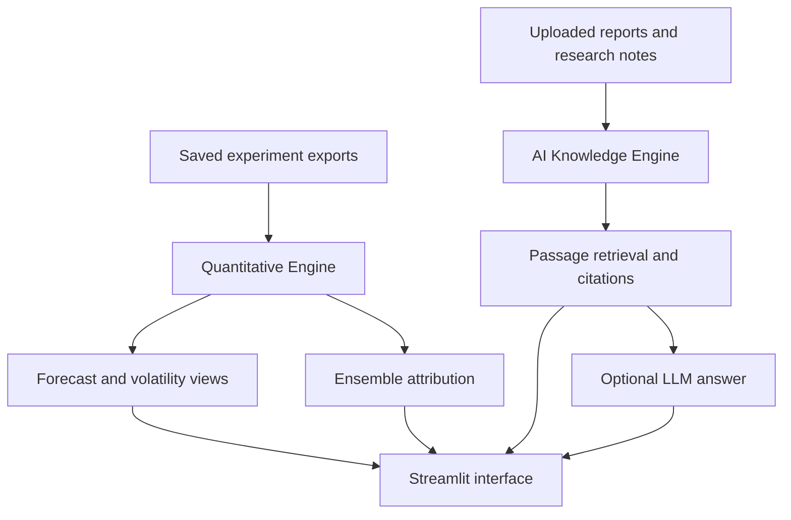

# AAPL Intelligent System

A Streamlit research application for exploring Apple stock forecasting results, ensemble explanations, volatility and financial-report evidence.

Developed as a fourth-year undergraduate research project in Statistics and Operations Research at the University of Peradeniya.

**This repository runs a saved-results dashboard.** It includes historical predictions and attribution exports; it does not train models or produce live market forecasts. The training notebook and fitted model binaries are not included.

## Features

| Page | What you can explore |
| --- | --- |
| Overview / Home | Research snapshot, two-engine architecture and navigation shortcuts |
| Model comparison | Price errors, directional metrics, confidence intervals and experiment seeds |
| Forecast visualization | Actual and predicted historical close prices |
| Volatility / GJR-GARCH | Conditional volatility and variance evaluation |
| Explainable AI | Ridge contributions and XGBoost TreeSHAP; diagnostics for other models |
| Financial report RAG | Upload PDF/TXT/Markdown, retrieve cited passages and optionally generate an English answer |

The interface uses a blue-and-white theme. All retained price models appear in the research snapshot; GJR-GARCH is evaluated separately as a volatility model.

## Architecture



The engines share an interface. Retrieved report text is not a training feature for the saved price forecasts.

## Quick start with Anaconda on Windows

Extract or clone this repository. Open Anaconda Prompt and change to the folder containing `app.py` and `requirements.txt`:

```bat
cd /d "C:\path\to\aapl-intelligent-system"
conda create -n aapl_dashboard python=3.11 -y
conda activate aapl_dashboard
python -m pip install -r requirements.txt
python -m streamlit run app.py --server.address 127.0.0.1
```

Open **http://localhost:8501**. Keep the terminal open; use Ctrl+C to stop. For later launches, activate the environment, enter the repository folder and run the last command again.

Alternatively, with standalone Python 3.11 or 3.12, run `setup_windows.bat` once and then `run_windows.bat`.

### macOS or Linux

```sh
python3 -m venv .venv
source .venv/bin/activate
python -m pip install -r requirements.txt
python -m streamlit run app.py --server.address 127.0.0.1
```

TensorFlow and XGBoost are not dashboard dependencies: the app reads saved outputs.

## Included experiment

- Supplied source coverage: 4 January 2010–1 October 2026; 4,212 raw observations and 4,192 after feature warm-up.
- Saved test targets: 1 April 2024–1 October 2026; 629 observations per seed.
- Seeds: 42, 123 and 2026.
- Base price models: ARIMA, BiLSTM and Transformer.
- Meta-models: Ridge and XGBoost.
- Comparators: WeightedAvg and MajorityDirection.
- Volatility: GJR-GARCH, compared with constant variance.

Primary-seed results, from `data/test_metrics_by_seed.csv`:

| Model | RMSE USD | Direction accuracy % |
| --- | ---: | ---: |
| BiLSTM | 4.202 | 49.44 |
| Transformer | 4.193 | 53.26 |
| ARIMA | 4.194 | 49.44 |
| WeightedAvg | 4.185 | 51.67 |
| Ridge | 4.621 | 44.99 |
| XGBoost | 65.670 | 44.52 |
| MajorityDirection | 4.625 | 55.33 |

This experiment did not demonstrate stacking superiority. The historical test era was inspected in earlier project work, so it is not a fresh confirmatory holdout. These supplied data have not been independently verified as a point-in-time market archive. Results do not establish trading profitability.

## Financial report retrieval

Retrieval works without an API key. Built-in passages describe the research; company annual reports are not bundled. Upload a text-based report, index it, then ask a specific English question. For example: “What was net sales in 2024?” Check the source year, page and units in the returned evidence.

The implementation uses BM25-style lexical retrieval, not vector embeddings. Scanned PDFs require OCR beforehand. Upload limits are 20 MB and 250 pages per PDF. Documents and last-search results are stored in session memory, not a durable database. Availability dates are user-supplied filters.

### Optional generated answers

Use the page's LLM connection settings, environment variables, or copy `.streamlit/secrets.toml.example` to `.streamlit/secrets.toml`. Fill in your own `OPENAI_API_KEY` and `OPENAI_MODEL`. Do not commit the populated file.

Only when generation is enabled and a search is submitted does the app send the question and retrieved passages to the configured OpenAI request path. API charges may apply. Generated answers are in English. Citation identifiers are checked, but this does not prove citation support or factual correctness. Live API generation has not been validated in the packaging checks.

## Tests

Run from the repository root after installing requirements:

```sh
python -m unittest discover -s tests -v
```

The existing five tests cover page navigation, seeds, retrieval interaction, home shortcuts, source/date filtering and additive reconstruction of saved ensemble outputs. GitHub Actions runs this suite on Python 3.11 and 3.12. See [validation notes](docs/VALIDATION.md) for the checks actually executed when preparing this package.

## Repository layout

| Path | Purpose |
| --- | --- |
| `app.py` | Streamlit interface and charts |
| `rag.py` | Extraction, retrieval and optional generation |
| `data/` | Saved experiment exports and built-in research corpus |
| `tests/` | Existing UI and data checks |
| `.streamlit/` | Theme and blank secrets example |
| `.github/workflows/tests.yml` | Automated test workflow |
| `docs/` | Architecture, validation and upload instructions |

## Research boundaries

Ridge and XGBoost have additive attribution exports. Other model views are diagnostics, not full neural feature explanations. Live trading, portfolio allocation, transaction costs, continuous inference, OCR, authentication and persistent report storage are outside this application. User acceptance and financial-question accuracy have not been established.

See [data documentation](data/README.md) and [architecture](docs/ARCHITECTURE.md). To publish this folder, follow [GitHub upload instructions](docs/GITHUB_UPLOAD.md).

## Reuse

No open-source license has been assigned in this package. The repository owner should choose a license appropriate to their code and confirm rights to redistribute the included experimental data. Third-party dependencies retain their own licenses.
